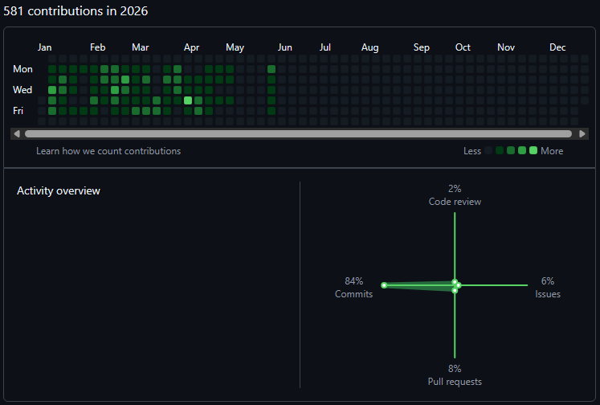
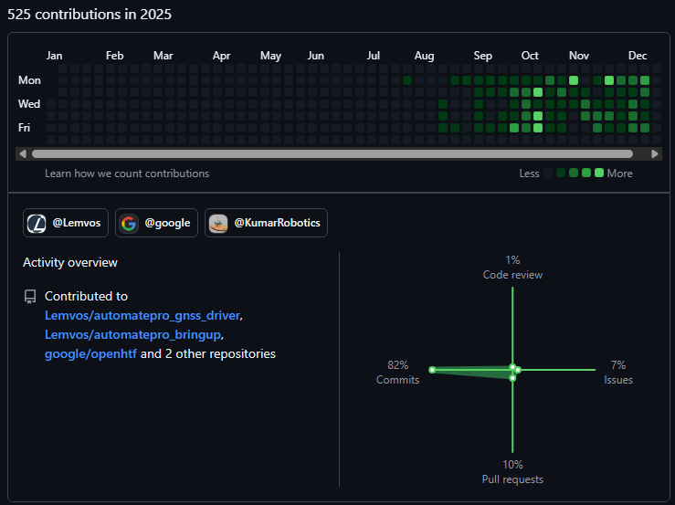

## :wave: Simone Contorno - Robotics Software Engineer

**Focus:** Autonomous systems / ROS 2 / C++ / Navigation / Control / Embedded Linux  
**Location:** Germany  
**Contact:** [LinkedIn](https://www.linkedin.com/in/simone-contorno) / [Website](https://simone-contorno.github.io) / [Email](mailto:simone.contorno@outlook.it)

I work on the software behind autonomous robotic systems, from ROS 2 architecture, navigation and control to embedded integration, debugging and real-world deployment. My focus is on building reliable autonomy software that works beyond simulation.

---

### :robot: What I build

- Autonomy software architecture and integration for **unmanned surface vehicles (USVs)** at Lemvos: perception -> planning -> control, state estimation, and mission management in **ROS 2/Nav2**
- **EKF-based sensor fusion**: GNSS + IMU for real-time navigation state estimation
- **ROS 2 lifecycle drivers** with watchdog recovery for camera, GNSS, and IMU subsystems; Jetson Orin **kernel customization** for embedded hardware compatibility
- **Image segmentation** on NVIDIA Jetson Orin: Isaac ROS integration, model fine-tuning with custom-annotated data (CVAT/SAM), TensorRT conversion for on-device inference
- **Foxglove Studio extensions** for configuration, autonomous goal/waypoint control, AIS vessel data display, and sonar depth visualization via WebSocket
- System observability: **Grafana + Prometheus + Loki** dashboards, alerting, and per-process monitoring
- **Debian package CI/CD** via GitHub Actions; production network management with ModemManager and NetworkManager
- **System integration and field validation**: debugging autonomy software on physical platforms through lake and sea trials

---

### :wrench: Core Stack

`C++` `Python` `ROS 2` `Nav2` `EKF` `NVIDIA Jetson` `Linux` `Gazebo` `Foxglove` `Docker` `Git`

---

### :briefcase: Work Activity

Most of my current work lives in private repositories at **[@Lemvos Robotics](https://github.com/lemvos)**. Earlier experience includes C++/ROS 2 NMPC research at LS2N and automotive test automation and ECU validation at Enginium.

Snapshots of my GitHub contribution activity, including work at Lemvos:

*Historical snapshots - June 2026 | Includes Lemvos and other GitHub contributions; not live statistics*

---

### :pushpin: Featured Projects

| Project | Description |
|---|---|
| [ProxMPC](https://github.com/simone-contorno/prox_mpc) | Primary open-source project / C++ NMPC core + ROS 2/Nav2 controller plugin / SQP + ProxQP / simulation benchmarks; hardware validation pending |
| [MyNMPC](https://github.com/simone-contorno/mynmpc) | LS2N / EMARO+ master's thesis / C++ + ROS 2 NMPC using ProxQP / integrated on ROSbot 2R and Renault Zoe research platforms |
| [Mobile Robot AI](https://github.com/simone-contorno/mobile_robot_ai) | Experimental ROS 2/Nav2 navigation in Gazebo / PID path following / linear regression trained on PID data |

---

### :hammer_and_wrench: Tools & Platforms

**Robot Middleware**

**Languages**

**Platforms & OS**

**Tools**

